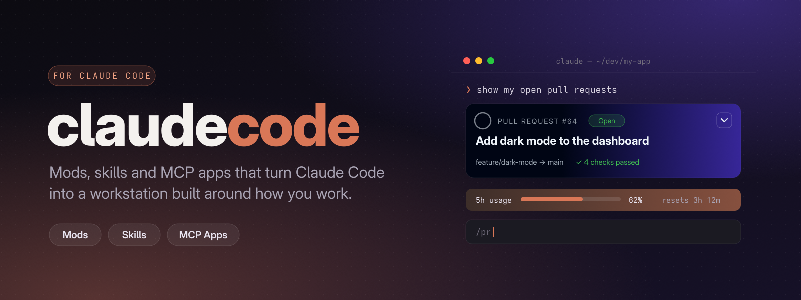

# claudecode — mods, skills and MCP apps for Claude Code

<p align="center">
  
</p>

<p align="center">
  <a href="LICENSE"></a>
  <a href="https://claude.com/claude-code"></a>
  <a href="https://modelcontextprotocol.io/"></a>
</p>

<p align="center">
  <a href="#features"><b>What's inside</b></a> ·
  <a href="#getting-started"><b>Getting started</b></a> ·
  <a href="#usage"><b>Usage</b></a> ·
  <a href="#roadmap"><b>Roadmap</b></a>
</p>

## Overview

`claudecode` is a collection of add-ons that make Claude Code feel less like a chat window and more like a developer workstation. **Mods** put live information right in your session, such as a pull request card under the push that created it, a usage bar above the prompt, or a tree of what your subagents are doing. **MCP apps** bring interactive cards into ChatGPT and Claude conversations. **Skills** teach Claude repeatable workflows. Everything here is open source and meant to be forked, tweaked and made your own.

## Features

### MCP apps

<table>
  <tr>
    <td width="96" align="center"></td>
    <td>
      <b><a href="mcps/pulltile">Pulltile</a></b> · <i>available</i><br />
      Your GitHub pull requests as cards in ChatGPT and Claude. Expand a card for checks, changed files, commits and review feedback, then review or merge without leaving the chat. Each user signs in with their own GitHub account.
    </td>
  </tr>
</table>

### Mods

Mods run inside Claude Code itself, in the terminal and the desktop app's Code tab.

| Mod | What it does | Status |
|---|---|---|
| **[pr-card](mods/pr-card)** | A pull request card inline in the conversation: state, CI checks, reviews and unresolved threads, with **Fix with Claude** to hand one review thread to Claude as a focused task | Coming soon |
| **[pr-bar](mods/pr-bar)** | A bar above the prompt that follows your branch's pull request, with a status-aware animated background | Coming soon |
| **[pr-panel](mods/pr-panel)** | A side pane with the whole pull request: checks, reviews, files and commits | Coming soon |
| **[usage-bar](mods/usage-bar)** | Your plan's usage limits and context fill above the prompt, with reset countdowns and a seasonal theme | Coming soon |
| **[subagent-monitor](mods/subagent-monitor)** | A live tree of running subagents: what each one is doing, how long it has run and what it costs | Coming soon |
| **[context-guardian](mods/context-guardian)** | Tracks decisions and checkpoints in long sessions and writes a handoff note before context runs out | Planned |

### Skills

Reusable Claude Code skills for recurring workflows live in [`skills/`](skills). The first ones are on the way.

## Requirements

- **Claude Code** — for mods and skills, a recent version with function-hook mods enabled (the mod API is early access)
- **Node.js 24.18+** — for running MCP apps locally
- **GitHub CLI (`gh`)**, signed in — used by the pull request mods
- **A ChatGPT or Claude account with custom connectors** — to use MCP apps in chat

Each item's own README lists anything extra it needs.

## Getting Started

### Installation

```bash
git clone https://github.com/kernastra/claudecode.git
```

```bash
cd claudecode
```

Then follow the README of whatever you want to use:

| Type | Where | How it's installed |
|---|---|---|
| MCP app | `mcps/<name>` | `npm install`, configure `.env`, run or deploy it, then add its URL as a connector in ChatGPT or Claude |
| Mod | `mods/<name>` | Point Claude Code at the folder with `--plugin-dir` or the `CLAUDE_CODE_PLUGIN_DIRS` setting |
| Skill | `skills/<name>` | Copy the folder into `~/.claude/skills/` |

## Usage

**Try Pulltile on your own account in a couple of minutes:**

```bash
cd mcps/pulltile
```

```bash
npm install
```

```bash
SKYBRIDGE_SINGLE_USER=1 npm run dev
```

Open `http://localhost:3000`, pick `list-pull-requests` and click **Run** to see your pull requests as cards. To use it in ChatGPT or Claude with sign-in for other people, follow the setup in the [Pulltile README](mcps/pulltile#configuration).

**Load a mod for one session** once its code is published:

```bash
claude --plugin-dir ./mods/pr-card
```

<!-- ===== Repo-Specific Sections ===== -->

## Project Structure

```text
claudecode/
├── mcps/                  # MCP apps for ChatGPT and Claude
│   └── pulltile/          # GitHub pull requests as cards
├── mods/                  # In-session add-ons for Claude Code
│   ├── pr-card/
│   ├── pr-bar/
│   ├── pr-panel/
│   ├── usage-bar/
│   ├── subagent-monitor/
│   └── context-guardian/
├── skills/                # Claude Code skills
└── docs/assets/           # README images
```

## Roadmap

- **Publish the mods** — the pull request card, bar and panel, the usage bar and the subagent monitor already run day to day and are being cleaned up for release
- **Context Guardian** — session checkpoints and handoff notes for long-running work
- **First skills** — packaged workflows for reviews, releases and session notes

Ideas and pull requests are welcome; open an issue to talk through anything bigger.

## License

This project is licensed under the MIT License — see [LICENSE](LICENSE) for details.

<sub>A community project, not affiliated with or endorsed by Anthropic. Claude and Claude Code are trademarks of Anthropic.</sub>
