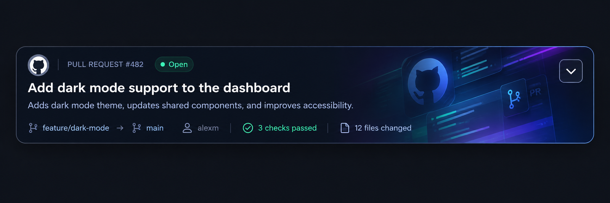
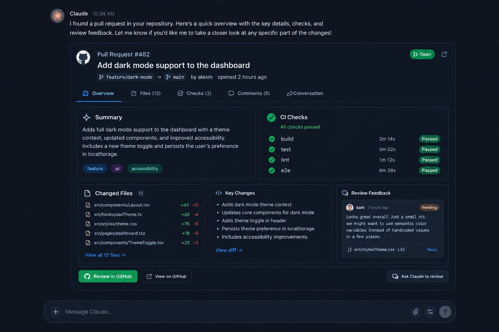

# Pulltile — your GitHub pull requests as cards in ChatGPT and Claude

<p align="center">
  
</p>

[](../../LICENSE)
[](https://www.typescriptlang.org/)
[](https://modelcontextprotocol.io/)

## Overview

Pulltile is an MCP app that shows your GitHub pull requests as cards right inside a ChatGPT or Claude conversation. Ask "what's open on my repos?" and you get one card per pull request, with its status, branches, author and CI checks. Expand a card to read the summary, changed files, recent commits and review feedback, then open it on GitHub, hand it to the assistant for a review, or merge it without leaving the chat. Each person signs in with their own GitHub account and chooses which repositories Pulltile can see, so it works for anyone, not just whoever deployed it.

## Features

- **Pull request cards** — one card per PR with state (open, draft, merged, closed), source and target branch, author, check results and files changed
- **Expandable details** — the dropdown shows the full description and labels, every CI check with its duration, the first changed files with line counts, recent commits, and the latest review feedback
- **Merge from the card** — a two-step "Merge into main" button that's disabled with the reason when GitHub would refuse (conflicts, branch protection, behind base, draft)
- **Ask the assistant to review** — one click sends a review request for that PR into the conversation
- **Your repositories only** — users sign in with GitHub and install the app on just the repos they want on their cards
- **Filters in plain language** — "show merged PRs on my-app" or "list the last 10 PRs" picks the repo, state and count for you
- **Works in ChatGPT and Claude** — built on the open MCP Apps standard, with ChatGPT's Apps SDK extensions

<p align="center">
  
</p>

## Tech Stack

| Component | Technology |
|-----------|------------|
| **MCP server and views** | [Skybridge](https://docs.skybridge.tech) 2 (TypeScript) |
| **Card UI** | React 19 |
| **Sign-in** | [Clerk](https://clerk.com) as the OAuth server for MCP clients (dynamic client registration, JWT access tokens) |
| **GitHub access** | A GitHub App, using each user's own token against the GitHub GraphQL and REST APIs |
| **Hosting** | [Alpic](https://alpic.ai), or any host that can run a Node server |

## Getting Started

### Prerequisites

- **Node.js** 24.18 or later, with npm
- **A GitHub account**, to create the GitHub App users sign in with
- **A Clerk account**, free tier is fine
- **GitHub CLI (`gh`)**, logged in, only for single-user local development

### Installation

```bash
git clone https://github.com/kernastra/claudecode.git
```

```bash
cd claudecode/mcps/pulltile
```

```bash
npm install
```

### Configuration

Copy `.env.example` to `.env` and fill it in.

| Variable | Required | Description |
|---|---|---|
| `CLERK_FRONTEND_API` | Multi-user | Your Clerk Frontend API host, e.g. `your-app.clerk.accounts.dev` |
| `CLERK_SECRET_KEY` | Multi-user | Clerk secret key, used server-side to read each user's GitHub token |
| `GITHUB_APP_SLUG` | Multi-user | Your GitHub App's slug (`github.com/apps/<slug>`), used for the "Choose repositories" link |
| `MERGE_TOKEN_SECRET` | Optional | Signs merge confirmations; set the same value on every instance if you run more than one |
| `SKYBRIDGE_SINGLE_USER` | Local only | Set to `1` to run on your own `gh` login without Clerk; refused in production |

The server refuses to start without either the Clerk variables or `SKYBRIDGE_SINGLE_USER=1`.

**One-time setup for multi-user mode:**

1. **Create a Clerk application** with GitHub as the only sign-in method. Open its GitHub connection, turn on **Use custom credentials**, and copy the **Authorization Callback URL**.
2. **Create a GitHub App** at [github.com/settings/apps/new](https://github.com/settings/apps/new):
   - **Callback URL** — Clerk's Authorization Callback URL
   - **Expire user authorization tokens** — off
   - **Request user authorization during installation** — off
   - **Webhook** — inactive
   - **Repository permissions** — Pull requests: read and write · Contents: read and write · Checks: read · Commit statuses: read · Metadata: read
   - **Account permissions** — Email addresses: read
   - **Where can this GitHub App be installed?** — Any account
3. **Back in Clerk**, paste the GitHub App's client ID and a new client secret into the GitHub connection.
4. **In Clerk → OAuth applications → Settings**:
   - Turn on **Publish CIMD support** and set client admission to **Any compatible CIMD client**
   - Turn on **Publish DCR support**
   - Set **Access token format** to **JWT access tokens**
5. **Copy** the Frontend API URL and secret key from Clerk → API keys into `.env`, along with your GitHub App's slug.

Use a Clerk application dedicated to Pulltile; the server accepts access tokens from any OAuth client registered on that application.

## Usage

**Try it locally on your own account** (no Clerk needed):

```bash
SKYBRIDGE_SINGLE_USER=1 npm run dev
```

Open the devtools at `http://localhost:3000`, pick `list-pull-requests` and click **Run**. Single-user mode only answers requests from your own machine.

**Connect it to ChatGPT or Claude** (multi-user, with Clerk configured):

1. Start the server and give it a public HTTPS URL, either with a tunnel for testing or by deploying:

   ```bash
   npm run dev:tunnel
   ```

   ```bash
   npm run deploy
   ```

2. Add `https://<your-host>/mcp` as a connector:
   - **Claude** — Settings → Connectors → Add custom connector
   - **ChatGPT** — turn on Developer mode, then add an app at chatgpt.com/plugins with OAuth authentication
3. Sign in with GitHub when prompted, then install the GitHub App on the repositories you want to see.
4. Ask things like:
   - "Show my open pull requests"
   - "What's open on my-app?"
   - "List the last 10 merged PRs"

**What to expect:**

- Pulltile scans the 30 repositories you pushed to most recently; name a repo to look at one directly.
- Merging always uses the repository's default merge method, and only merges the exact commit shown on the card.
- Cards use a dark design in both light and dark mode.

<!-- ===== Repo-Specific Sections ===== -->

## Project Structure

```text
pulltile/
├── src/
│   ├── server.ts               # MCP tools: list-pull-requests (with card view) and merge-pull-request
│   ├── github.ts               # GitHub API queries, PR data shaping, merge
│   ├── auth.ts                 # Clerk sign-in → per-user GitHub token; single-user dev mode
│   ├── merge-token.ts          # Signed, short-lived merge confirmations
│   ├── views/
│   │   └── list-pull-requests.tsx  # The card UI
│   ├── index.css               # Card styles
│   └── assets/pr-card-bg.jpg   # Card background art
├── brand/                      # App icon (SVG source and PNG exports)
├── docs/assets/                # README images
├── SPEC.md                     # Product spec and design decisions
├── AGENTS.md                   # Instructions for AI coding agents working on this app
└── .env.example                # Configuration template
```

## Troubleshooting

**"This app isn't available to remote clients yet"**
The server is running in single-user mode, which only answers requests from your own machine. Configure the Clerk variables to serve ChatGPT, Claude or a tunnel.

**Sign-in fails with `invalid_scope`**
Your Clerk application's **Default scopes for dynamic clients** must include `email`, `profile` and `offline_access`, which are the scopes Pulltile asks for.

**"The GitHub App isn't installed on owner/repo"**
Install the app on that repository from `https://github.com/apps/<your-slug>/installations/new`, or from GitHub → Settings → Applications.

**No cards, just a "Choose repositories" button**
You're signed in, but the GitHub App isn't installed on any repository yet. Click the button and pick your repositories.

## License

This project is licensed under the MIT License — see [LICENSE](../../LICENSE) for details.
