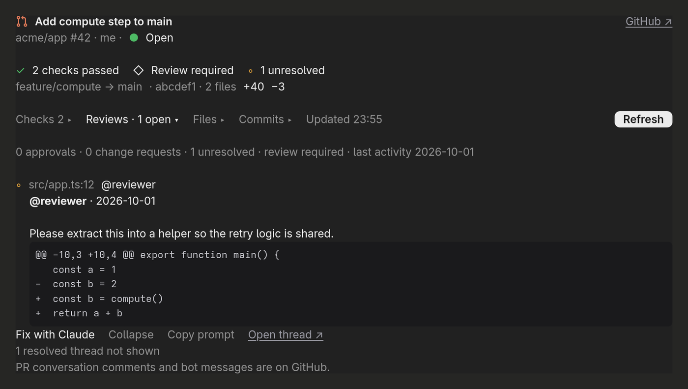
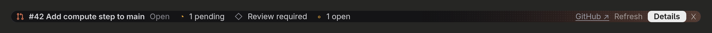
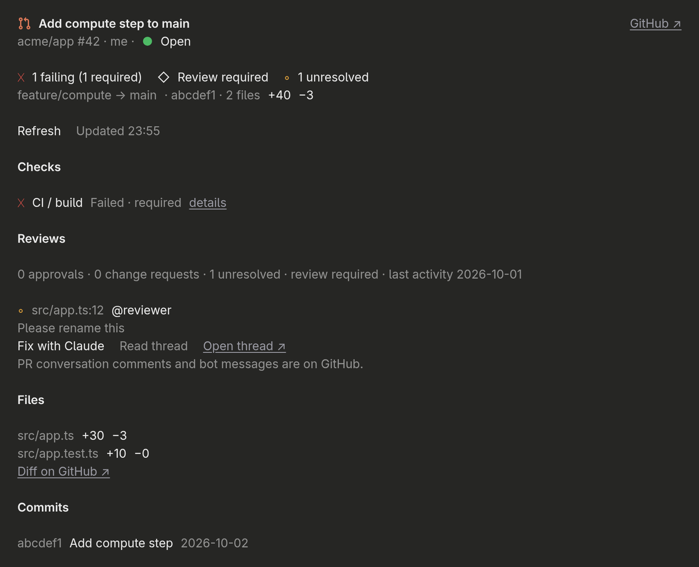
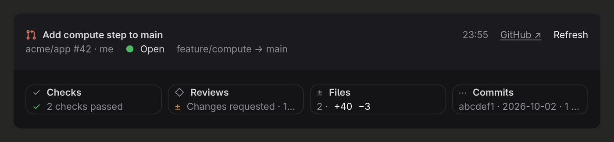

# pr-card — GitHub pull requests inside Claude Code

<p align="center">
  
</p>

A Claude Code mod that keeps your pull request in view while you work. It draws a card for the PR right in the conversation, with its state, CI checks, reviews and unresolved review threads, and a **Fix with Claude** button that hands one review thread to Claude as a focused task. A PR bar above the prompt follows your branch's PR, and a details pane shows everything at once. It works in the terminal and in the Claude desktop app's Code tab from the same code.

## Features

- **`/pr` card** — run `/pr` for the current branch's PR, or `/pr 123`, `#123`, `owner/repo#123` or a PR URL; the command's output becomes the card
- **Cards under Claude's pushes** — after Claude runs `gh pr create`, `gh pr view` or a `git push` that maps to a PR, the card appears right under it
- **PR bar above the prompt** — comes up on its own when your branch has a PR and follows any PR Claude creates; on desktop its background breathes orange, races amber dots while checks run, and turns red on failures or conflicts
- **Details pane** — the bar's **Details** button or `/pr-details` opens a side pane with every section open: checks, reviews, unresolved threads, files and commits
- **Tiles layout** — `/pr-tiles` shows the same PR as a header strip and four clickable tiles for Checks, Reviews, Files and Commits
- **Fix with Claude** — on any unresolved review thread, sends Claude the comment, the file and line, the diff hunk and the current code; **Copy prompt** puts the same text on your clipboard instead
- **Checks and reviews at a glance** — failing checks first, `required` where GitHub reports it, approvals, change requests and who is still to review
- **A tool Claude can call** — `show_pr_card` gives Claude a one-line status (state, check and review counts), never the text of review comments
- **Stays current** — refreshes on demand, after pushes, and in the background while checks are still settling

## Screenshots

**The PR bar above the prompt**, and its animated background as checks pass, run and fail:

<p align="center">
  
</p>
<p align="center">
  
</p>

**The details pane** (`/pr-details`), with every section open:

<p align="center">
  
</p>

**The tiles layout** (`/pr-tiles`):

<p align="center">
  
</p>

<sub>The card, bar, pane and tiles are the mod's own desktop drawing from its test run, with a sample `acme/app` pull request, rendered outside Claude Code; spacing and fonts in the app can differ slightly. The animated bar is rendered from the mod's art code.</sub>

## Requirements

- **Claude Code** with function-hook mods. It was written against Claude Code 2.1.288, and the mod API is early access, so it may change between releases.
- **GitHub CLI (`gh`)**, signed in (`gh auth status`). The mod uses `gh`'s stored login and never reads or prints a token. Private repositories need the `repo` scope.
- **github.com repositories.** GitHub Enterprise hosts aren't recognized.

## Installation

```bash
git clone https://github.com/kernastra/claudecode.git
```

**For a single session:**

```bash
claude --plugin-dir /path/to/claudecode/mods/pr-card
```

**For every session**, add the folder to `CLAUDE_CODE_PLUGIN_DIRS` in the `env` block of `~/.claude/settings.json`. Separate several mods with `:`, for example alongside the [usage bar](../usage-bar):

```json
{ "env": { "CLAUDE_CODE_PLUGIN_DIRS": "/path/to/claudecode/mods/usage-bar:/path/to/claudecode/mods/pr-card" } }
```

Remove the path to turn it off. Claude Code writes the mod API's type declarations into `.claude-plugin/types/` the first time it loads the folder; they're generated, so they aren't in the repo.

## Usage

| Command | What it does |
|---|---|
| `/pr [ref]` | Show the card for the current branch's PR, or for a number, `owner/repo#123` or a PR URL |
| `/pr-band [ref]` | Show the PR bar for any PR; with no argument it toggles the bar |
| `/pr-details [ref]` | Open the details pane with every section expanded |
| `/pr-tiles [ref]` | Show the card in the tiles layout |

In the PR bar, **✕** hides it for the rest of the session. Press Esc or the pane's close mark to close the details pane.

### Configuration

Set these through Claude Code's config menu, or in `~/.claude/settings.json` under `pluginConfigs["github-pr-card"].options`:

| Option | Default | What it does |
|---|---|---|
| `pollSeconds` | `60` | How often a card with pending checks or unknown mergeability refreshes, while it was viewed in the last 30 minutes. Minimum 15; `0` turns background refresh off. |
| `autoAttach` | `true` | Draw the card under successful `gh pr create`, `gh pr view` and `git push` rows |
| `prBar` | `auto` | `auto`: the bar shows for your branch's PR and for PRs Claude pushes. `manual`: only after `/pr-band`. |

<!-- ===== Repo-Specific Sections ===== -->

## Safety

- **Read-only on GitHub** — one GraphQL query and `gh pr list`. The mod never merges, approves, comments, resolves threads or checks out branches.
- **Review comments are treated as untrusted** — in the Fix with Claude prompt they sit inside a fenced block with control characters stripped, and Claude is told to treat them as a description of a change, not as instructions.
- **Risky commands wait for you during a fix** — while a Fix with Claude turn runs, any Bash command that pushes, writes to the PR, or resets, switches or cleans git state asks for your approval first, whatever your permission mode.
- **Wrong branch, no surprises** — if your local branch isn't the PR's branch, Claude is told to stop and ask before switching.

## Known limitations

- **Only pushes Claude makes are noticed.** A push from your own terminal, an IDE or GitHub's website doesn't reach Claude Code; run `/pr` to see that PR.
- **The desktop card stays dark** in light mode.
- **Conversation and bot comments aren't shown;** the card links to GitHub for them.
- **Very large PRs are capped** at 100 checks, 100 review threads (20 comments each) and 100 files. The card says when there's more and links to GitHub.
- **"Required" checks** only show when your account can see the branch protection rules.
- **Another mod drawing above the prompt** can hide the PR bar if it doesn't pass the space along. The [usage bar](../usage-bar) shares it correctly.

## Project Structure

```text
pr-card/
├── .claude-plugin/plugin.json   # Mod manifest and settings (name: github-pr-card)
├── hooks/
│   ├── register.tsx             # Commands, events, refresh and the model tool
│   ├── card.tsx                 # The inline card (panel layout)
│   ├── card-tiles.tsx           # The tiles layout behind /pr-tiles
│   ├── band.tsx                 # The PR bar and its animated background
│   ├── github.ts                # gh calls and response parsing
│   ├── status.ts                # Check, review and merge status
│   ├── prompt.ts                # The Fix with Claude prompt
│   └── refs.ts                  # Parsing PR references and git remotes
├── tests/                       # 47 tests: parsing, status, hostile input, rendering, refresh, the push hold
├── docs/
│   ├── card.png, bar.png, pane.png, tiles.png   # Screenshots for this README
│   ├── bar.svg                  # Animated PR bar image for this README
│   └── render-bar.ts            # Regenerates bar.svg from hooks/band.tsx
└── ARCHITECTURE.md              # How it's built on the mod API, for contributors
```

The mod's internal name is `github-pr-card`, which is the key used in Claude Code's plugin settings.

Run the tests from the repo root:

```bash
claude plugin test ./mods/pr-card
```

## Acknowledgements

- The PR bar's panel and the tiles layout follow the style of [effortless](https://github.com/HeyCubit/effortless) (MIT, © 2026 HeyCubit); layout and palette only, the art is this mod's own.
- The pull request icon is from [GitHub Octicons](https://github.com/primer/octicons) (MIT).

## License

This project is licensed under the MIT License — see [LICENSE](../../LICENSE) for details.
