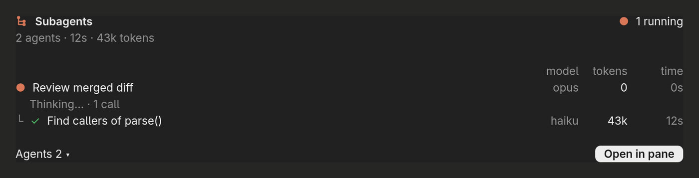
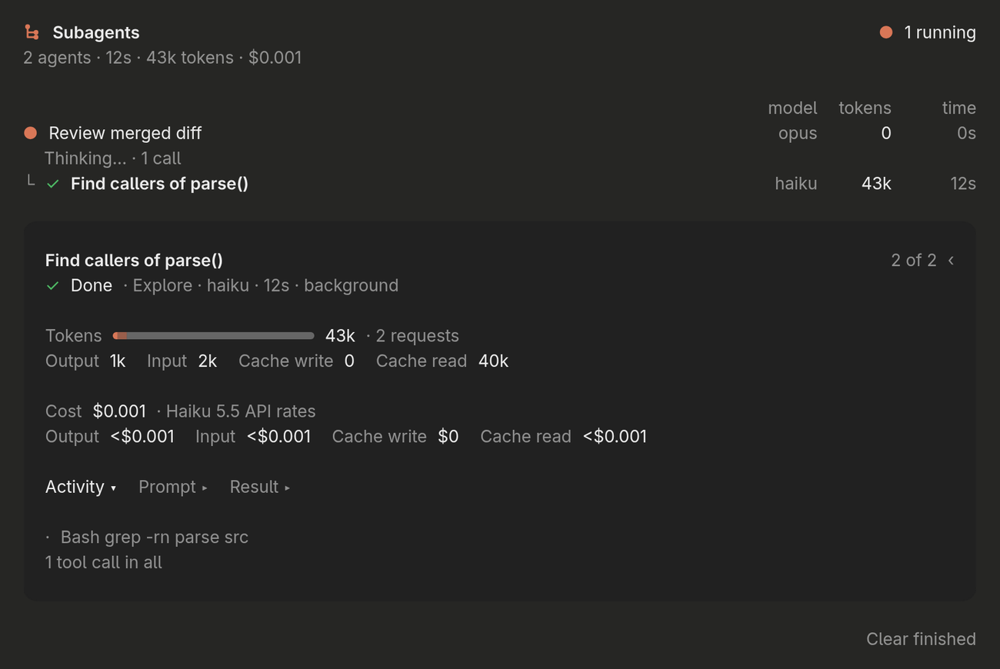

# subagent-monitor — a live tree of what your subagents are doing

<p align="center">
  
</p>

A Claude Code mod that shows your subagents as a live tree, right where Claude started them. Each agent gets a row with its status, model, tokens and running time, and nested agents sit under the agent that spawned them. A side pane opens the first time a session starts a subagent, so you can follow any agent in detail: what it's doing now, its token breakdown, its cost, and its prompt and result. It works in the terminal and in the Claude desktop app's Code tab from the same code.

## Features

- **Live tree in the conversation** — replaces Claude's Agent rows with one card: running agents marked `●`, finished `✓`, failed `✕`, stopped `⊘`, and children drawn under their parent with `└`
- **Model, tokens and time per agent** — aligned columns, with elapsed time that keeps counting while an agent runs
- **What it's doing right now** — a running agent shows its current step and how many tool calls it has made, e.g. `Thinking… · 1 call`
- **Side pane with the details** — opens on its own the first time a session spawns a subagent, or with `/agent-tree`; step between agents with `‹` and `›`
- **Token breakdown** — a bar and figures for output, input, cache writes and cache reads, plus how many requests the agent made
- **Cost estimate** — what each agent cost at Claude Haiku 5.5 API rates, request by request, including long-context pricing above 100k tokens
- **Activity, prompt and result** — expand any of the three to see the agent's recent tool calls, what it was asked, and what it answered
- **Tidy up** — **Clear finished** removes completed agents from the pane

<p align="center">
  
</p>

<p align="center"><sub>Both images are the mod's own drawing from its test run, with sample agents, rendered outside Claude Code; spacing and fonts in the app can differ slightly.</sub></p>

## Requirements

- **Claude Code** with function-hook mods. It was written against Claude Code 2.1.288, and the mod API is early access, so it may change between releases.

## Installation

```bash
git clone https://github.com/kernastra/claudecode.git
```

**For a single session:**

```bash
claude --plugin-dir /path/to/claudecode/mods/subagent-monitor
```

**For every session**, add the folder to `CLAUDE_CODE_PLUGIN_DIRS` in the `env` block of `~/.claude/settings.json`. Separate several mods with `:`:

```json
{ "env": { "CLAUDE_CODE_PLUGIN_DIRS": "/path/to/claudecode/mods/subagent-monitor" } }
```

Remove the path to turn it off. Claude Code writes the mod API's type declarations into `.claude-plugin/types/` the first time it loads the folder; they're generated, so they aren't in the repo.

## Usage

The tree appears on its own whenever Claude starts subagents. Use **Agents ▾** on the card to collapse or expand the list, and **Open in pane** to follow one in detail.

| Command | What it does |
|---|---|
| `/agent-tree` | Open the side pane with this session's subagents |

**In the pane:**

| Control | What it does |
|---|---|
| `‹` `›` | Step to the previous or next agent |
| **Activity**, **Prompt**, **Result** | Expand the agent's recent tool calls, its prompt, or its answer |
| **Clear finished** | Remove completed agents from the pane |

<!-- ===== Repo-Specific Sections ===== -->

## Known limitations

- **Costs always use Claude Haiku 5.5 prices.** An agent on another model is still priced at Haiku 5.5 rates, and the pane says so. Treat other models' costs as a rough guide only.
- **Cache writes are priced at the 5-minute rate,** because Claude Code doesn't report which cache lifetime a write used.
- **Agents started before the mod loaded** show in the tree from their transcript row, but without tokens or cost.
- **Totals are for this session only;** the tree starts empty in a new session.

## Project Structure

```text
subagent-monitor/
├── .claude-plugin/plugin.json   # Mod manifest (name: agent-tree)
├── hooks/
│   ├── register.tsx             # Tracks agents, their tokens and status; /agent-tree; the inline card and pane
│   ├── view.tsx                 # Draws the tree, the columns and the detail pane
│   └── pricing.ts               # Haiku 5.5 API rates, including long-context pricing
├── tests/                       # The tree, the pane and pricing
├── types/index.d.ts             # Agent records stored per session
└── docs/                        # README images
```

The mod's internal name is `agent-tree`, which is the key used in Claude Code's plugin settings.

Run the tests from the repo root:

```bash
claude plugin test ./mods/subagent-monitor
```

## License

This project is licensed under the MIT License — see [LICENSE](../../LICENSE) for details.
