# usage-bar — your Claude plan usage and context fill, right above the prompt

<p align="center">
  
</p>

<p align="center"><sub>The band's animated background for each month, rendered from the mod's own theme code.</sub></p>

A Claude Code mod that shows how much of your plan's 5-hour and 7-day usage you've spent, when each window resets, and how full the current session's context window is, all in one compact band above the prompt. It runs in the terminal and in the Claude desktop app's Code tab from the same code. On desktop, the band has a softly animated background that changes with each month's holiday.

## Features

- **5-hour and 7-day meters** — percentage used for each usage window, with a "resets in 3h 12m" countdown that keeps ticking while the session sits idle
- **Context fill** — tokens used against the context window, e.g. `62k / 200k`, so you can see a compaction coming
- **Fits any width** — each meter picks the richest form that fits on one row, from full labels down to short numbers
- **Seasonal themes on desktop** — a faint animated wash with drifting particles for each month: snow in December, bats in October, hearts in February
- **Theme preview** — `/usage-theme` shows any month's theme for the current session
- **Follows your theme** — terminal colors come from your `/theme`, and the desktop meters read on light and dark
- **Plays well with others** — other mods that share the band, such as a pull request bar, stack above the usage row

## Requirements

- **Claude Code** with function-hook mods. It was written against Claude Code 2.1.288, and the mod API is early access, so it may change between releases.
- **A Claude subscription** for the 5-hour and 7-day meters, which only appear when Claude Code reports plan usage limits. Context fill always shows.

## Installation

```bash
git clone https://github.com/kernastra/claudecode.git
```

**For a single session:**

```bash
claude --plugin-dir /path/to/claudecode/mods/usage-bar
```

**For every session**, add the folder to `CLAUDE_CODE_PLUGIN_DIRS` in the `env` block of `~/.claude/settings.json`. Separate several mods with `:`.

```json
{ "env": { "CLAUDE_CODE_PLUGIN_DIRS": "/path/to/claudecode/mods/usage-bar" } }
```

Remove the path to turn it off. Claude Code writes the mod API's type declarations into `.claude-plugin/types/` the first time it loads the folder; they're generated, so they aren't in the repo.

## Usage

The band appears on its own in every session once the mod is loaded, reading your usage when the session starts and updating after each reply.

| Command | What it does |
|---|---|
| `/usage-theme oct` | Preview a month's theme for this session. Takes a number (`10`), a month (`oct`, `october`) or a holiday (`halloween`). |
| `/usage-theme auto` | Go back to the current month's theme |

**Themes by month:**

| Month | Theme | Month | Theme |
|---|---|---|---|
| January | New Year's | July | Independence Day |
| February | Valentine's Day | August | Late summer |
| March | St. Patrick's Day | September | Labor Day |
| April | Easter | October | Halloween |
| May | Mother's Day | November | Thanksgiving |
| June | Father's Day | December | Christmas |

<!-- ===== Repo-Specific Sections ===== -->

## Project Structure

```text
usage-bar/
├── .claude-plugin/plugin.json   # Mod manifest (name: usage-band)
├── hooks/
│   ├── hooks.json               # Entry point list
│   ├── register.tsx             # The band: usage readings, layout, /usage-theme
│   └── seasons.ts               # Monthly themes and the animated SVG background
├── tests/usage-band.test.ts     # Layout and theme tests
├── docs/
│   ├── themes.svg               # Animated theme gallery for this README
│   └── render-themes.ts         # Regenerates themes.svg from hooks/seasons.ts
└── types/index.d.ts             # Shared types for the usage snapshot
```

The mod's internal name is still `usage-band`, which is the key used in Claude Code's plugin settings.

## License

This project is licensed under the MIT License — see [LICENSE](../../LICENSE) for details.
