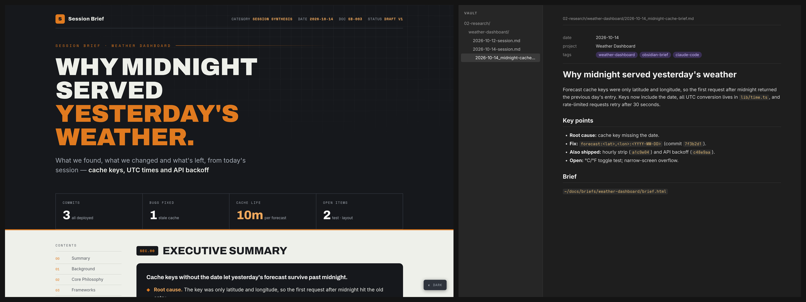

# obsidian-brief — turn a work session into a designed brief and a linked vault note

<p align="center">
  
</p>

<p align="center"><sub>Example: a brief and its vault note for a sample project's debugging session.</sub></p>

A Claude Code skill that sums up the current session in two linked pieces: a designed HTML brief you can share, and a note in your Obsidian vault that points to it. The brief links back to the note with an `obsidian://` link, so you can jump between them. It uses only what was worked out in the session; it never adds outside research.

## Features

- **Two artifacts, cross-linked** — the note links to the brief; the brief's footer opens the note in Obsidian
- **Same design as research-brief** — header with key figures, summary, decisions, takeaways and a contents sidebar
- **Session only** — a "Basis" section states that the brief is a first-person synthesis with no outside sources
- **Asks when unclear** — if the session's focus isn't obvious, Claude asks before writing
- **No invented facts** — uncertainty is stated, not filled in

## Requirements

- **Claude Code**
- **The [research-brief](../research-brief) skill**, whose `template.html` this skill uses
- **An Obsidian vault**

## Installation

```bash
git clone https://github.com/kernastra/claudecode.git
```

```bash
cp -r claudecode/skills/obsidian-brief ~/.claude/skills/
```

Claude Code picks up skills in `~/.claude/skills/` in new sessions. To use it in one project only, copy it into that project's `.claude/skills/` instead.

### Configuration

| Variable | Default | What it sets |
|---|---|---|
| `OBSIDIAN_VAULT` | `~/vault` | Your Obsidian vault folder |
| `BRIEFS_DIR` | `~/docs/briefs` | Where briefs are saved |

Set them in the `env` block of `~/.claude/settings.json`.

## Usage

At the end of a focused session, say:

- "turn this into a brief"
- "brief this session"
- `/obsidian-brief <topic>` to name the focus yourself

Claude reports the paths of both files.

## License

This project is licensed under the MIT License — see [LICENSE](../../LICENSE) for details.
