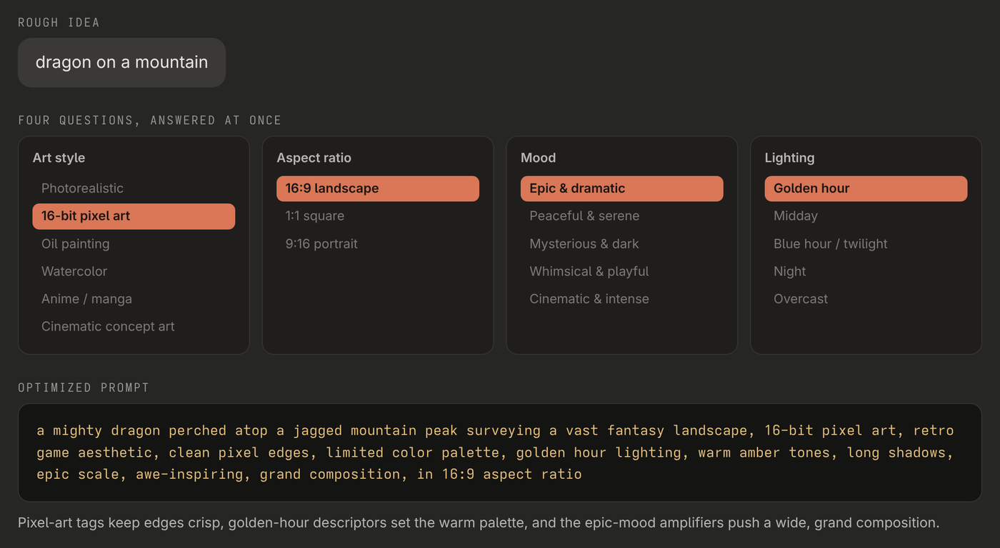

# prompt-optimizer — turn a rough idea into a detailed image prompt

<p align="center">
  
</p>

<p align="center"><sub>The skill's worked example: four quick choices turn three words into a full prompt.</sub></p>

A Claude Code skill that takes a short image idea, asks four quick multiple-choice questions, and writes a polished prompt for any image generator. The questions cover art style, aspect ratio, mood and lighting, and each answer adds the descriptors that generator models respond to.

## Features

- **Four questions at once** — art style, aspect ratio, mood and lighting, answered in a single step
- **Six art styles** — photorealistic, 16-bit pixel art, oil painting, watercolor, anime/manga and cinematic concept art, each with its own quality tags
- **Lighting and mood vocabulary** — golden hour, blue hour, night and more, plus mood amplifiers from epic to whimsical
- **Copy-ready output** — the prompt in a code block with a one-line explanation of the choices
- **Works with any generator** — offers to run the prompt if an image tool is available, otherwise it's ready to paste

## Requirements

- **Claude Code**

## Installation

```bash
git clone https://github.com/kernastra/claudecode.git
```

```bash
cp -r claudecode/skills/prompt-optimizer ~/.claude/skills/
```

Claude Code picks up skills in `~/.claude/skills/` in new sessions. To use it in one project only, copy it into that project's `.claude/skills/` instead.

## Usage

```text
/prompt-optimizer dragon on a mountain
```

Or ask in your own words: "optimize this image prompt: a lighthouse in a storm". Claude asks the four questions, then gives you the finished prompt.

## License

This project is licensed under the MIT License — see [LICENSE](../../LICENSE) for details.
