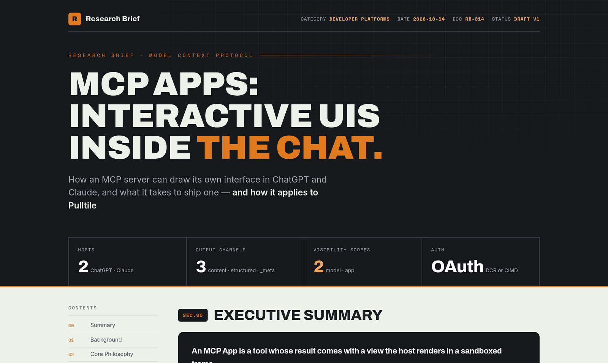

# research-brief — deep research, delivered as a designed HTML brief

<p align="center">
  
</p>

<p align="center"><sub>Example brief on MCP Apps, written from sources used while building <a href="../../mcps/pulltile">Pulltile</a>.</sub></p>

A Claude Code skill that researches a person, tool, idea or framework across several sources, then writes a self-contained HTML brief with a strong visual design. Every brief explains the subject, its core ideas and named concepts, and how it applies to your own projects, with every source it actually read listed at the end.

## Features

- **Two waves of research** — three parallel searches from different angles, then targeted follow-ups to fill gaps
- **Reads the sources** — fetches at least three pages instead of summarizing search snippets
- **Applied to your work** — a section with specific suggestions for your own projects, not generic advice
- **Designed output** — Archivo, Space Mono and Inter type, an amber-and-ink palette, a key-figures cluster, a contents sidebar that tracks your place, and a dark-mode toggle
- **Self-contained** — one HTML file you can open, share or keep in your notes
- **No invention** — frameworks, quotes and credentials are only included when a source says so

## Requirements

- **Claude Code** with web search and fetch available
- **Internet access** when the brief is opened, for its web fonts

## Installation

```bash
git clone https://github.com/kernastra/claudecode.git
```

```bash
cp -r claudecode/skills/research-brief ~/.claude/skills/
```

Claude Code picks up skills in `~/.claude/skills/` in new sessions. To use it in one project only, copy it into that project's `.claude/skills/` instead.

### Configuration

| Variable | Default | What it sets |
|---|---|---|
| `BRIEFS_DIR` | `~/docs/briefs` | Where briefs are saved |

Set it in the `env` block of `~/.claude/settings.json`.

## Usage

Ask for a brief in your own words:

- "deep dive into context engineering"
- "research CrewAI and report back"
- "who is <person> and how does their approach apply to us?"

Claude saves `<briefs>/<subject>-brief.html` and tells you the path, then offers to log the research with [session-note](../session-note).

<!-- ===== Repo-Specific Sections ===== -->

## Project Structure

```text
research-brief/
├── SKILL.md         # The research workflow and quality bar
├── template.html    # The brief's design; every {{PLACEHOLDER}} is filled per brief
└── docs/            # README image
```

[obsidian-brief](../obsidian-brief) reuses `template.html`, so install both if you want session briefs too.

## License

This project is licensed under the MIT License — see [LICENSE](../../LICENSE) for details.
