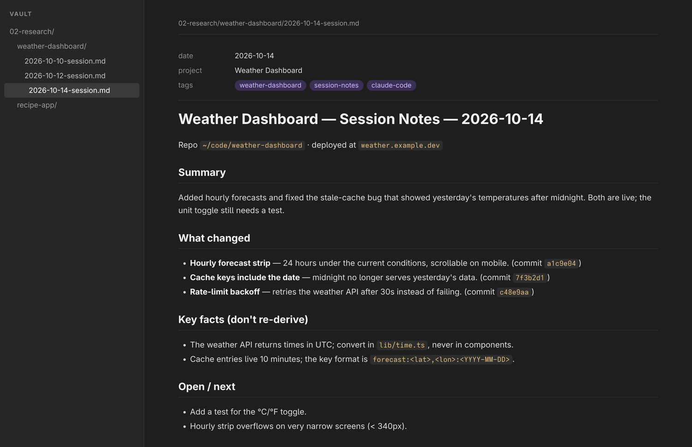

# session-note — log every work session to your Obsidian vault

<p align="center">
  
</p>

<p align="center"><sub>Example note for a sample project.</sub></p>

A Claude Code skill that writes a dated note at the end of a work session, so you (and Claude) can pick up exactly where you left off. Each note records what changed, with commit hashes, the facts worth not re-discovering, and what's still open. Pair it with [session-resume](../session-resume), which reads the latest note back at the start of the next session.

## Features

- **One note per project per day** — `YYYY-MM-DD-session.md` in the project's folder; later sessions the same day are appended, never overwritten
- **Traceable** — commit hashes made during the session are listed next to each change
- **Built to be resumed** — a fixed `## Open / next` section that `session-resume` looks for
- **Plain markdown** — frontmatter with date, project and tags, so Obsidian's search and graph pick it up
- **Honest** — uncertain details are flagged rather than filled in

## Requirements

- **Claude Code**
- **An Obsidian vault** (or any folder of markdown notes)

## Installation

```bash
git clone https://github.com/kernastra/claudecode.git
```

```bash
cp -r claudecode/skills/session-note ~/.claude/skills/
```

Claude Code picks up skills in `~/.claude/skills/` in new sessions. To use it in one project only, copy it into that project's `.claude/skills/` instead.

### Configuration

| Variable | Default | What it sets |
|---|---|---|
| `OBSIDIAN_VAULT` | `~/vault` | Your Obsidian vault folder |

Set it in the `env` block of `~/.claude/settings.json`, for example `{ "env": { "OBSIDIAN_VAULT": "/home/you/Notes" } }`. Notes go in `<vault>/02-research/<project-slug>/`.

## Usage

Say any of these at the end of a session:

- "save a session note"
- "log this session"
- "update the vault"

Claude writes the note and tells you the path. Obsidian shows it immediately.

## License

This project is licensed under the MIT License — see [LICENSE](../../LICENSE) for details.
