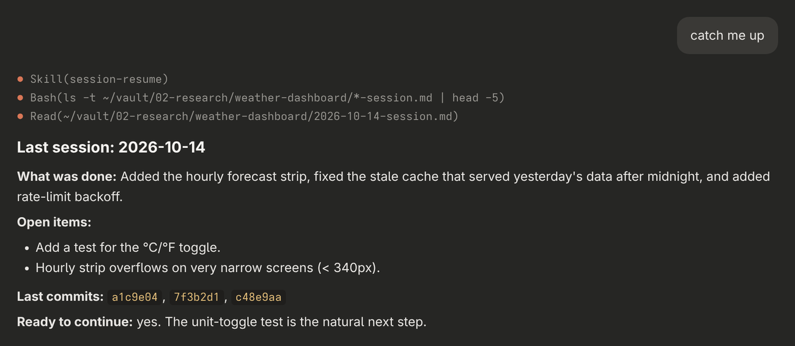

# session-resume — pick up where the last session left off

<p align="center">
  
</p>

<p align="center"><sub>Example reply, built from the sample note shown in <a href="../session-note">session-note</a>.</sub></p>

A Claude Code skill that reads the most recent session note for the current project from your Obsidian vault before work starts, and gives you a short catch-up: what was done, what's open, the last commits, and whether anything is needed before continuing. It only reads; it never changes your notes. It's the other half of [session-note](../session-note).

## Features

- **Finds the right note** — works out the project from the folder you're in, or from the project you name
- **Open items first** — pulls the `## Open / next` list to the top, since that's where work resumes
- **Commit trail** — lists the hashes from the last session so you can check what shipped
- **Same-day aware** — still reads today's earlier note if you're back after a break
- **Read-only** — never edits the vault

## Requirements

- **Claude Code**
- **Notes written by [session-note](../session-note)**, or in the same layout

## Installation

```bash
git clone https://github.com/kernastra/claudecode.git
```

```bash
cp -r claudecode/skills/session-resume ~/.claude/skills/
```

Claude Code picks up skills in `~/.claude/skills/` in new sessions. To use it in one project only, copy it into that project's `.claude/skills/` instead.

### Configuration

| Variable | Default | What it sets |
|---|---|---|
| `OBSIDIAN_VAULT` | `~/vault` | Your Obsidian vault folder |

Set it in the `env` block of `~/.claude/settings.json`, for example `{ "env": { "OBSIDIAN_VAULT": "/home/you/Notes" } }`. Notes go in `<vault>/02-research/<project-slug>/`.

## Usage

Start a session with any of these:

- "resume"
- "what were we doing?"
- "catch me up"

If there's no note yet for the project, Claude says so and offers to look through the rest of the vault.

## License

This project is licensed under the MIT License — see [LICENSE](../../LICENSE) for details.
